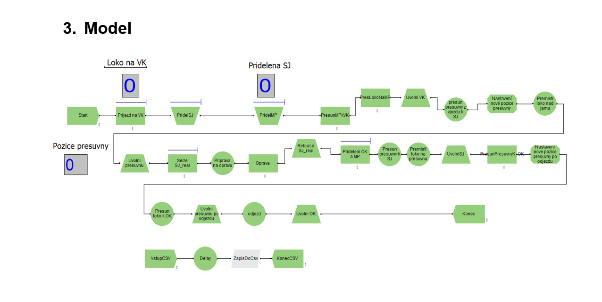

# 🎓 Semestrální práce B – Modelování a simulace

Semestrální práce z předmětu **Modelování a simulace (KST/BMOSI)** na Univerzitě Pardubice, Fakultě elektrotechniky a informatiky.

## 👨‍🎓 Informace o projektu

- **Autor:** Aleš Tlučhoř
- **Univerzita:** Univerzita Pardubice
- **Fakulta:** Fakulta elektrotechniky a informatiky (FEI)
- **Studijní obor:** Informační technologie
- **Ročník:** 3. ročník
- **Semestr:** Zimní
- **Akademický rok:** 2025/2026
- **Předmět:** Modelování a simulace
- **Typ práce:** Semestrální práce B
- **Hodnocení:** 6 bodů včetně bonusových

## 📖 Popis projektu

Cílem práce je vytvořit simulační model provozu opravny lokomotiv v prostředí **Arena Simulation** a ověřit, zda nedochází k přetížení systému.

Model simuluje příjezd lokomotiv do opravny, jejich přesun pomocí manipulační přesuvny, přidělování servisních jam a následný odjezd po dokončení opravy.

Simulace se zaměřuje na:
- Využití jednotlivých servisních jam.
- Vytížení manipulační přesuvny a kolejí.
- Čekací doby lokomotiv.
- Odhalení případného přetížení systému.
- Návrh optimalizačních opatření pro efektivnější provoz opravny.

## 🚂 Simulační model v Areně

Simulační model byl vytvořen v prostředí **Arena Simulation**.

Model zachycuje celý proces průjezdu lokomotivy opravnou – od příjezdu na vjezdovou kolej (VK), přes přidělení servisní jámy (SJ), přípravu a samotnou opravu až po přesun na odjezdovou kolej (OK) a opuštění opravny.

Opravna využívá čtyři servisní jámy, vjezdovou a odjezdovou kolej a manipulační přesuvnu (MP).

## 🛠️ Použité technologie

- **Arena Simulation** – tvorba a provádění simulačního modelu.
- **Microsoft Excel** – zpracování a vyhodnocení výsledků simulací.

## 🎯 Závěr

V rámci práce byl vytvořen simulační model opravny lokomotiv, na kterém bylo možné analyzovat vytížení jednotlivých zdrojů a identifikovat případné kapacitní problémy.

Na základě výsledků byly navrženy optimalizační varianty zahrnující zkrácení doby opravy a rozšíření kapacity opravny o další servisní jámu.

---

*Univerzita Pardubice – Fakulta elektrotechniky a informatiky*  
*Akademický rok 2025/2026*
